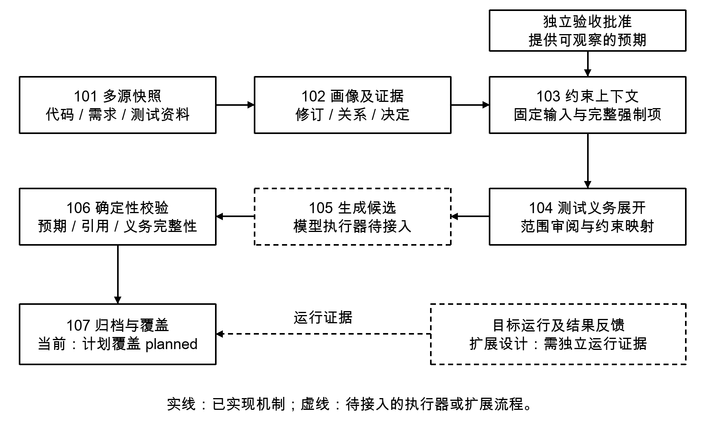
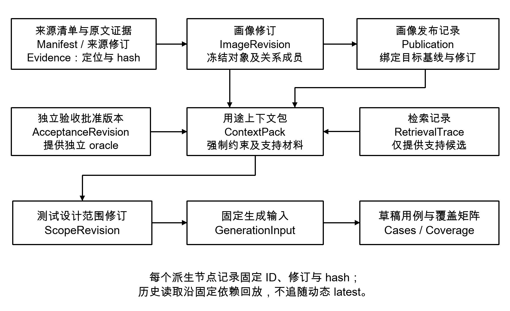
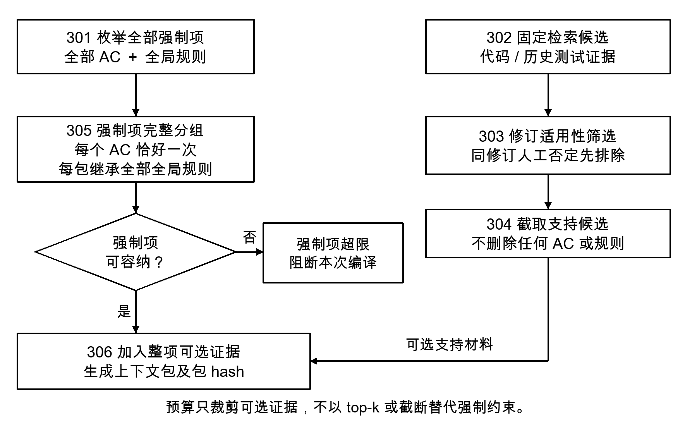
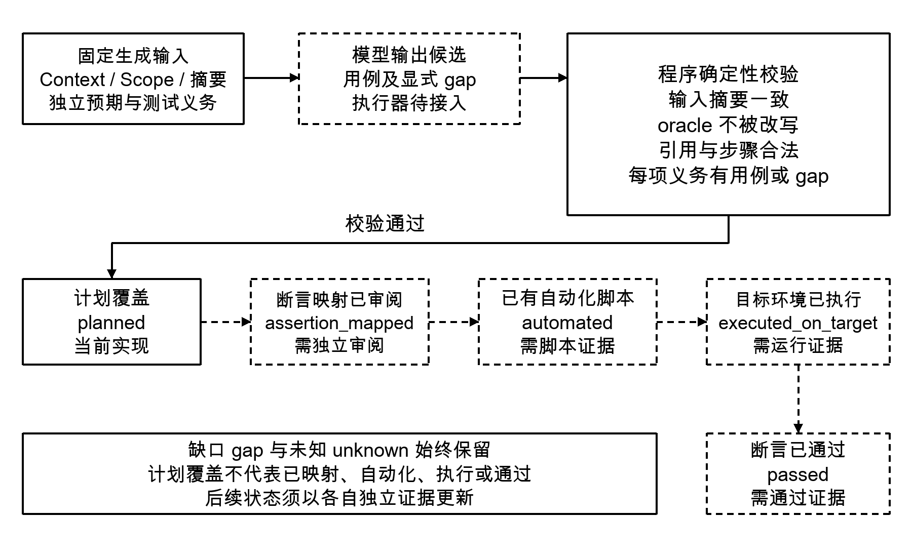
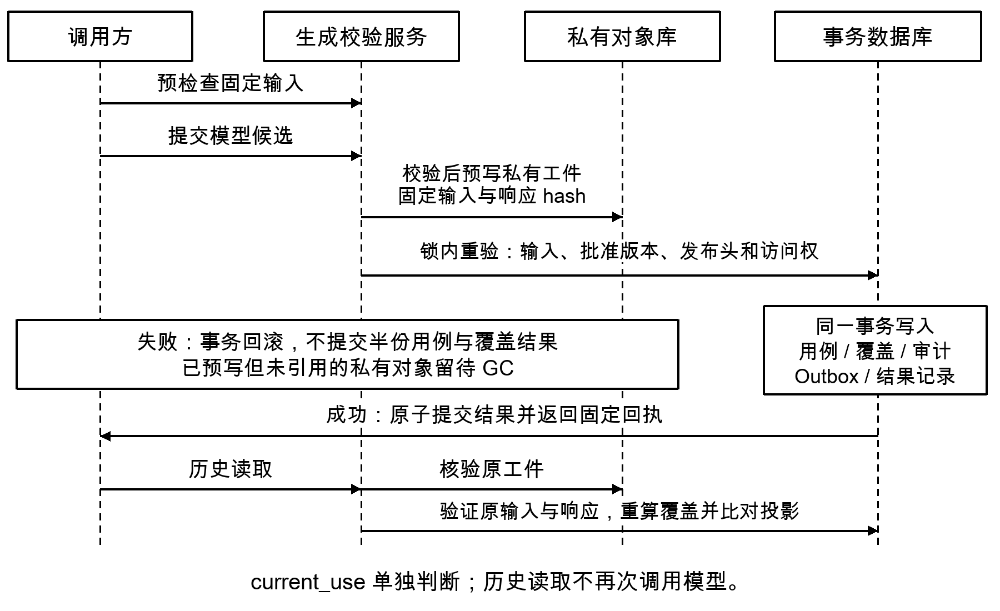

# 一种基于版本化系统画像与独立验收约束的软件测试生成及校验方法

> Nasus 专利立项评审 Wiki · 中国发明专利方向 · 内部评审版 V1.0 · 2026年9月28日

## 目录

- [立项概览](#overview)
- [一 背景和现有技术](#background)
- [二 技术方案](#technical-solution)
  - [总体结构和固定来源](#system-architecture)
  - [独立验收判据](#independent-oracle)
  - [完整约束分包](#budget-partition)
  - [生成校验与历史复核](#output-validation)
  - [设计扩展](#execution-extension)
  - [订单退款实施例](#refund-example)
- [三 技术保护点](#protection-points)
- [四 技术效果与业务效果](#effects)
- [附录 A 实现依据与核验记录](#implementation-evidence)
- [附录 B 公开资料及评审待办](#references)

<a id="overview"></a>

## 立项概览

### 立项建议

建议有条件立项，并围绕“固定验收义务如何约束测试生成及结果接收”开展进一步检索和申请论证。当前项目已有来源快照、独立验收批准、完整约束分包、候选输出校验与结果归档的实现基础，足以支撑具体技术交底；正式模型执行器、独立断言映射和新链路的真实运行反馈仍需补齐。

拟保护的核心是：在固定版本的代码、需求及测试证据上，独立确定验收判据，形成不能被检索排名或模型输出缩小的测试义务集合；对生成结果逐项核对，并在提交前复验其依赖，使历史结果可按原输入复核。

### 评审需要判断的事项

第一，是否认可将完整义务集合及其贯穿编译、校验和归档的约束关系作为主要发明点。第二，是否同意补充对照实验及更贴近权利要求的检索。第三，是否将运行反馈保留为扩展实施方式，避免用尚未完成的端到端能力支撑现阶段效果结论。

### 主要不确定性

已有专利公开了多源软件资料、知识图谱、版本证据包、提示分片及生成复核，宽泛的“系统画像加大模型测试生成”区别不足。独立判据、预算分包和审计回放也各有既有技术，需进一步论证本方案步骤间的相互制约及组合效果。[[1]](#ref-1)[[2]](#ref-2)[[3]](#ref-3)[[4]](#ref-4)[[5]](#ref-5)

### 阅读与证据口径

正文依次说明背景、技术方案、保护点和效果；附录列出实现证据及公开资料。文中“已实现”指撰稿时的本地工作区存在对应实现，“设计扩展”指本文明确给出实施路径但尚未贯通。“构造示例”与真实实验结果分别标识。

撰稿时按此前未公开、未申请的状态整理。检索截止日为2026年9月28日。未填写未经确认的申请人、发明人及申请日期。本稿用于内部立项，不代替正式申请文件或完整专利检索意见。

<a id="background"></a>

## 一 背景和现有技术

### 1 软件变更使验证依据持续漂移

软件质量验证至少需要回答三个不同的问题：系统当前实现了什么、需求要求系统做什么、已有测试实际验证了什么。这三类信息分别存在于代码、需求文档和测试资产中，更新节奏并不一致。若检索时默认读取最新内容，同一次测试设计可能混入旧需求、新代码和另一个分支的用例，即使各条信息本身正确，其组合也可能不适用于目标版本。

本项目将“系统画像”定义为软件系统在特定来源组合下的结构、行为线索及验证资产的可追溯表示。这里的画像是软件知识和证据模型，与操作系统镜像无关。它必须记录结论对应的来源版本和证据位置，才能支持后续复核。

### 2 检索相关性不能决定必测范围

检索增强生成通常从候选材料中选择排名靠前的片段，以适应模型输入容量。相关性高低能够辅助选择证据，却不能确定某条验收条件是否可以省略。例如退款功能中，正常退款路径与大量代码片段高度相似，而越权退款限制仅有一小段需求；若按同一排名裁剪，后者可能在进入模型前被删除。

因此，本方案把“必须验证的义务”与“帮助理解的材料”分为两类数据：义务来自固定且独立确认的需求，支持材料来自代码和历史测试检索。仅支持材料允许因预算而减少；义务不足以放入一个输入时，需要完整拆包或阻断。

### 3 生成输入和正确性判据需要分开

如果系统根据代码现状生成预期结果，再用该预期判断相同代码，现有缺陷可能被复制为正确答案。软件测试中的判据问题已有长期研究，规格、模型、契约和人工知识均可作为判据来源。[[5]](#ref-5) 本方案的工作是把来源差异编码为可检查的修订与权限关系，使代码事实不能通过生成过程自行升级为正式验收依据。

### 4 待解决的具体技术问题

本发明拟解决：在模型上下文容量有限、来源持续更新且模型输出可能遗漏或改写约束的条件下，如何保持软件测试义务与其版本证据一致，拦截不符合输入约束的候选结果，并使已接收结果及覆盖统计能够按原始依据复核。

业务动因是降低版本验证的不确定性；直接处理对象是修订化软件证据、验收约束、测试义务、模型输出及覆盖记录。

### 5 与接近的软件测试专利比较

以下对照以公开文本为依据，采用“已披露内容—拟论证差异—需核实问题”的方式。对某个细节未作明确披露的判断仅限本轮已核对内容，不等于完成新颖性检索。

| 文献及公开日 | 已披露的相关内容 | 本方案拟论证的差异 |
| --- | --- | --- |
| [[1]](#ref-1) CN121996618A<br>2026-05-08 | 需求、设计、测试文档与工程实体绑定；图谱和向量对齐检索，形成证据包后生成。权利要求1。 | 验收义务从固定来源独立枚举，支持材料排名不能缩小义务集合。 |
| [[1]](#ref-1) 权利要求2、5、6、7 | 版本、基线、hash、来源定位及结果反向实体关系校核。 | 独立验收修订与生成义务绑定；对义务全量对账；提交时检查原依赖仍适用。 |
| [[2]](#ref-2) CN117971698A<br>2024-05-03 | SOW分片，结合产品文档和历史用例生成；知识图谱检索。权利要求1—3、9。 | 按完整验收条件作为原子单元分包，逐包继承全局规则，并校验全部条件恰好覆盖。 |
| [[2]](#ref-2) 权利要求10—11 | 对候选用例评分筛选，并由第二模型结合原需求评价。 | 确定性校验器检查固定判据正文、摘要、合法引用及全量义务映射；独立来源不依赖第二模型评分。 |

### 接近程度与检索限制

[[1]](#ref-1)与本方案的整体处理链最接近，已使“多源软件材料、版本化证据和生成校核”的宽泛表述难以作为主要区别。[[2]](#ref-2)使“需求驱动、历史用例复用及分片生成”不宜单独作为发明点。上述差异仍须放入完整权利要求组合进一步比较。

[[1]](#ref-1)中文网页本轮未能稳定读取，使用了英文全文译文及页面保留的中文摘要；正式申请前应取得中文公开文本，逐项核验翻译和权利要求。本稿列示公开日期，不以最早优先权日期替代具体技术内容的公开日期；具体优先权支持另行核验。

资料来源：[[1]](#ref-1)[[2]](#ref-2)；本表是技术对照，不对专利有效性、侵权范围或授权结果作出判断。

### 6 通用机制的既有基础

| 既有方向 | 公开依据及关联 | 需要下探的区别 |
| --- | --- | --- |
| 预算控制与多提示 | [[3]](#ref-3) 权利要求涉及按重要性及预算压缩；说明书还披露超窗口拆为多个提示及保留查询。 | 完整AC与全部全局规则作为不可丢弃单元；以集合等式验证拆包完整性。 |
| 证据固定与回放 | [[4]](#ref-4) 权利要求1、6—7涉及证据排序、容量、模型及提示摘要记录和回放。 | 围绕测试义务、生成响应和覆盖派生进行复核；历史原文与当前适用性分别输出。 |
| 独立正确性判据 | [[5]](#ref-5) 综述规格、模型、契约等oracle来源及判定困难。 | 由修订引用、来源分类及消费规则阻止实现观察被替换为正式预期。 |
| 需求检索生成测试 | [[6]](#ref-6) 研究将检索增强模型用于从自然语言需求生成测试场景。 | 强制义务独立于召回集合；结果接受由可执行校验条件控制。 |

### 7 组合论证的方向

拟论证的技术联系是：固定来源和独立判据给出义务集合，分包完整性约束把该集合送入有限容量生成过程，输出校验继续使用同一集合对账，提交复验防止生成期间输入失效，历史读取按同一依赖重算覆盖。某一步被移除，后续步骤即可能失去完整分母、正确预期或版本对应关系。

单篇文件是否公开上述完整组合，和多篇文件是否给出组合启示，是两个不同问题。即使单篇未覆盖所有细节，也不能据此认定具有创造性。后续检索应继续覆盖需求追踪中的负反馈、检索前过滤、约束保持的提示拆分及版本化测试证据。

### 8 本文如何满足技术公开的需要

技术方案以输入字段、集合约束、处理顺序和失败条件展开；不把“智能分析”“自动理解”作为替代实施步骤的描述。当前中国相关审查说明强调具体应用中模型输入、输出及其与技术场景的关系应清楚记载。[[7]](#ref-7) 本文不提出新的基础模型训练方法，生成模型可替换，其候选输出须接受相同外部校验。

<a id="technical-solution"></a>

## 二 技术方案

<a id="system-architecture"></a>

### 1 总体结构及术语

系统由来源采集、画像与证据管理、独立验收批准、上下文编译、测试义务编译、模型候选生成、确定性校验及结果归档组成。图1中的运行反馈为扩展设计；现有核心产物是可复核的测试设计草稿及计划覆盖。



*图1 系统总体结构及实现边界*

验收条件简称AC，是一项需要被验证的要求；oracle为可观测验收判据；测试义务是编译后可以逐项对账的最小验证记录。缺口gap表示已识别但尚未得到充分处理的义务或材料。

正式画像固定一个来源清单及其实体、证据成员；发布记录将画像绑定到指定基线。上下文包ContextPack保存该画像下的完整约束与受控支持材料。范围修订ScopeRevision补充风险、权限、状态和正反例，再编译为生成输入。

实现可采用关系数据库保存修订和事务记录，对象存储保存不可变原文及工件，全文和向量索引用于召回。索引可以重建，不能代替原文证据和正式修订。处理器执行编译、校验和提交程序，各模块通过下述固定标识与摘要交换数据。

### 2 S101 固定来源并形成画像

为每个代码仓库、需求文件或测试集合登记binding_id，采集时解析为明确commit或文档修订。原始字节归档并计算SHA-256；建立来源清单，逐项写入source_revision、内容摘要及采集范围。多个仓库的一致性由该组合清单表达，不假设存在跨仓库原子提交。



*图2 固定标识和摘要组成的数据依赖关系*

| 对象 | 必要字段及用途 |
| --- | --- |
| SourceManifest 与 Evidence | 来源绑定与修订；原文hash；文件或章节定位；片段hash。支持定位和完整性核验。 |
| ImageRevision 与 Publication | 画像成员及hash；manifest/hash；发布基线、序号和预期旧head。固定实际消费版本。 |
| AcceptanceRevision 与 ContextPack | 验收判据、来源与批准修订；publication pin；完整约束、候选回执和分包hash。 |
| Scope 与 GenerationResult | 范围修订、义务行、输入摘要；原始响应、模型配置摘要、用例及覆盖投影。 |

核心对象为说明层逻辑结构；实际字段分布见附录A。摘要用于检查固定内容一致性，不证明来源内容本身正确。

<a id="independent-oracle"></a>

### 3 S102 独立确定可观测验收判据

解析需求文档后，先生成带原文证据的来源AC对象。具备权限的审阅者针对该精确画像及AC修订，单独确认业务预期，形成追加式AcceptanceRevision。正式修订包含四字段oracle、basis_digest、上一修订标识、批准状态及批准工件hash。来源导入、代码关联接受和历史测试通过都不会自动完成此批准。[I3](#impl-i3)

| oracle字段 | 含义 | 退款场景构造值 |
| --- | --- | --- |
| preconditions | 可建立且可检查的前置状态 | 订单O100已支付100元，尚无退款成功记录；用户U1拥有该订单。 |
| action | 需要施加的操作 | U1提交订单O100、金额100元、幂等键K1的退款请求。 |
| observation | 观察位置和时机 | 等待任务结束，读取退款响应及退款账本中O100的成功记录。 |
| expected_result | 明确的结果判据 | 业务处理成功；成功退款记录恰为1条，金额为100元。 |

消费时必须指定验收修订ID与hash。程序校验原AC的画像成员、来源和证据，再确认所选验收修订仍是当前有效的已批准头。不能通过动态选择最新批准替换请求中的修订。撤回或修正后，新消费被拒绝；有权限的历史审阅仍可看到当时的批准内容。

### 代码事实与验收依据的隔离规则

实现观察与正式预期分别分类，检索材料保留retrieval_candidate_not_coverage标记。代码中存在“重复请求返回成功”的分支，只能产生行为线索；是否允许该返回、账本是否只能增加一次，应由独立需求判据确认。没有有效判据的AC仍保留在完整集合内并标为缺口，不能被删除以制造就绪状态。

来源依据计算basis_digest；完整批准请求和私有工件另行计算摘要，提交时核对原确认请求及预期前驱。数据库以追加记录处理修订。独立来源降低循环自证风险，但不保证人工确认一定正确；错误的需求仍需通过需求审阅和真实验证发现。

### 4 S103 枚举义务并筛选支持材料

编译器先从固定画像枚举全部AC与业务规则，得到强制集合M；再读取与各AC绑定的归档检索轨迹。检索候选必须属于同一发布、画像及来源修订，并能回溯到冻结证据。召回不足只影响支持材料，不缩小M。



*图3 约束独立保留与候选筛选分包流程*

人工否定关系按关系类型及两端实体登记身份查找。身份和双方修订均相同的reject，先从候选池排除，再截取top-k；同身份但修订变化则标记需要重审，不自动继承否定或批准。仅标签相同不足以确定实体身份。[I1](#impl-i1)

程序固定所有相关审阅头，包括空集合的摘要，并在使用和提交边界复核。不同claim的accept不能覆盖仍适用的reject。若候选或审阅头超过可完整检查的上限，明确返回容量缺口，不能截断否定记录后继续。支持材料始终标为候选，关联相似度不等于测试覆盖。

<a id="budget-partition"></a>

### 5 S104 在预算内保留完整强制约束

设A为全部AC，G为全部全局业务规则。每个子包i包含AC子集Aᵢ及完整G，要求各Aᵢ两两不交且其并集等于A。当前尚无批准的规则局部适用范围，因此采用全部规则逐包继承的保守实现。每个AC的来源、完整字段、判据和权威引用一起进入子包，不按句子截断。[I2](#impl-i2)

```python
A = sort_by_stable_id(all_acceptance_criteria)
G = all_global_rules
groups, current = [], []
require(fits(mandatory([], G)))
for ac in A:
    if not fits(mandatory(current + [ac], G)):
        require(current != [])
        groups.append(current)
        current = [ac]
        require(fits(mandatory(current, G)))
    else:
        current.append(ac)
groups.append(current)
parts = []
for group in groups:
    part = mandatory(group, G)
    part = add_whole_optional_items_while_fit(part)
    parts.append(with_digest(part))
require(exact_partition(A, groups))
require(all_rules_present_and_all_parts_fit(parts))
archive_root_and_all_parts(parts)
```

fits衡量完整规范化载荷，而非仅计数需求文本。现有实现使用canonical JSON的UTF-8字节上界，包含子包元数据及预算字段，尚不是实际Provider token数。可选证据只整项加入；单个AC与G仍超限时，整次编译失败并返回需要增加预算的信息，不交付部分成功包。

### 分包构造示例

假设每包预算为8 KiB，已计入元数据的强制负载为：全局规则与公共固定字段2 KiB；AC1、AC2、AC3各占3 KiB。固定顺序贪心分为P1={AC1,AC2,G}和P2={AC3,G}，剩余空间才加入可选证据。这些数值仅说明算法，不是项目实测或token换算。

安全检查包括AC集合恰好覆盖一次、每包完整包含G、全部子包版本pin一致及各包未超限。将根清单与子包集合一起归档；根清单用于证明总体输入完整，不能不经容量检查直接作为一次模型输入。

### 6 S105 编译测试范围及固定义务集合

范围审阅在ContextPack之外追加修订，固定风险、权限、状态转换、不变量、正例、负例及未解决冲突。适用项提供独立oracle；不适用项记录理由；未知项形成gap。预检查发现未解决冲突、缺少oracle或范围缺口时，阻断正式生成。范围审阅不能修改原AC的预期。[I4](#impl-i4)

义务编译器为原AC、业务规则、范围项及正反例分别生成行。row_id由scope修订、类别和本地ID确定。每行保存关联原约束ID、证据引用、权威修订、oracle及其摘要。保留原约束分母与扩展义务分母，防止通过添加相似用例改变覆盖统计口径。

| 输入或输出 | 最小接口内容与约束 |
| --- | --- |
| GenerationInput | context_pin、scope_pin、完整义务行、mandatory_constraint_ids、global_rule_ids、允许的fact及复用case集合、input_digest。 |
| CandidateCase | case_id、前置条件、输入、steps、assertions、支持fact IDs、复用case IDs、完整global rule IDs。 |
| Assertion | row_id、step_index、oracle、oracle_digest。步骤索引必须指向该用例实际存在的步骤。 |
| Gap | gap_id、row_ids、原因。可和同一义务的候选用例并存；存在候选不自动消除gap。 |
| ModelOutput | input_digest、cases、gaps；严格JSON，拒绝重复键、未知字段、NaN及自动修复后继续接收。 |

### 生成组件的职责

模型只提出满足上述结构的候选。接入生成组件时采用按义务行生成测试步骤的系统协议，原文资料仅作为数据；不能由资料内的指令改变约束集合或输出协议。输入摘要覆盖语义输入及策略版本，不包含摘要字段自身，采用稳定键序的规范化JSON编码后计算SHA-256。

当前输出校验器限制单响应正文最多1 MiB、用例和gap各最多512项。超限直接拒绝，不截断用例或义务。当前归档记录模型配置及输入、输出摘要；正式执行器扩展还需固定并归档提示版本和内容摘要。可追踪不意味着再次调用模型会逐字复现。

<a id="output-validation"></a>

### 7 S106 校验候选并派生计划覆盖

校验器独立于生成模型运行。先重验固定输入，再核对响应input_digest；对每个用例检查身份唯一、支持及复用引用在允许集合内、全局规则ID集合一致。每条断言须引用合法义务行和存在的步骤，oracle正文逐字段相等且摘要相等。[I4](#impl-i4)



*图4 输出校验与不同覆盖状态的证据要求*

设O为全部义务行，Map(r)为引用行r的用例集合，Gap(r)为其缺口集合。只有对每个r∈O都满足Map(r)非空或Gap(r)非空，才允许接收响应。计划覆盖按至少关联一个候选的不同义务行计数，增加重复用例不扩大覆盖分子。

现有实现只产生planned，全部行仍保留unknown。assertion_mapped、automated、executed_on_target和passed均为false。每用例携带全部全局规则ID，不等于该用例实际断言了全部规则；全体义务的映射仍需逐行对账。

字段相等证明原判据未被改写，步骤索引证明引用存在，两者都不能证明步骤真的验证了判据。语义映射审阅、可执行断言与真实证据，是后续状态转换所需的独立环节，不能通过模型自评或结构校验自行提升。

### 8 S107 提交重验与历史复核

输出校验通过后，先把固定输入引用、模型配置、原始响应和校验结果写入私有内容寻址工件，再进入数据库事务。事务内锁定对应项目、权限及模型状态，复验来源、批准头、发布记录、scope和原始调用绑定；检查通过才同时写入草稿用例、覆盖矩阵、审计和Outbox。[I5](#impl-i5)[I6](#impl-i6)



*图5 内部提交端口及历史复核时序*

若生成期间批准被撤回、发布head改变或权限失效，本次提交失败，不自动切换最新输入。数据库中不留下半份业务结果；预写对象可能成为待回收的孤立工件，因此本方案不要求对象存储与数据库之间实现分布式恰好一次写入。

相同调用和相同输入输出幂等返回原结果；不同响应不能覆盖该调用历史。历史读取在当前权限下校验原工件hash，使用原ContextPack、scope及原始响应重算覆盖并对比数据库投影。当前是否适用另以current_use返回；新批准不改写旧内容，损坏的原工件则拒绝返回。此过程不重新调用模型。

<a id="execution-extension"></a>

### 9 设计扩展 从候选接口到真实执行

以下给出可实施的后续接入方式，不作为当前已完成能力。仓库已有本地分词器策略、token及费用预留辅助函数，但尚未贯通正式预算化执行器、公开生成入口及多批结果提交。[I7](#impl-i7)[I8](#impl-i8)

### 模型执行与多包汇总

执行器固定模型、分词器、提示版本和目的地址，先检查来源出网权限，再用绑定模型的本地分词器计数提示和输入，加上配置的协议开销上界，并预留最大输出token与费用；调用后按原生usage复核。字节分包仅作为前置组织方式；不满足真实窗口时，按完整义务继续拆包，仍无法容纳则停止。

对已批准scope，将全部义务集合O中的每一行（原AC、业务规则、正反例及范围项）与所需原AC、oracle及全部全局规则组成不可拆单元，按稳定row_id分组；各义务恰好分配一次，所需来源AC可以在多个生成包复制。每包包含根input_digest、part_id、获配row_id集合及内容hash。每包仅以获配row_id集合对账，保留原oracle和全局规则；根汇总重新以完整O对账。引用的其他约束只作为上下文。

每个调用先持久化调用预留和attempt标识，再发出模型请求。收到响应后保存原始字节及调用审计；超时且无法确认已计费请求结果时标记待核查，不无限自动重发。各包分别校验，汇总时按part_id和局部case_id确定全局身份，并对根义务集合再次全量对账。

现有0058归档端口只接受一个完整响应和一次调用审计，不能直接接收上述多批结果。扩展时新增生成组工件，保存所有分包请求、响应与审计摘要；全部分包均返回通过校验的响应后统一提交。响应可含显式gap；网络失败或未知调用结果不能转成需求gap，失败组保持待处理。

### 断言映射与目标运行

审阅者确认步骤确实检验对应oracle后，追加映射修订。脚本生成器从已确认映射生成断言，RunPlan固定目标构建摘要、环境配置摘要、脚本修订、测试数据版本及映射修订。Runner核对所访问目标的可信构建标识并保证运行期间目标不切换，再运行并保存run_id、断言ID、观察值、时间及trace等证据hash。

脚本通过语法与收集校验且映射有效，才进入automated；有相同目标构建的有效运行记录才进入executed_on_target；匹配判据的证据完成审阅或受控判断后才进入passed。环境错误、证据不足或构建不符分别记录，不能归为通过。反馈关联原义务，形成新候选或缺口；修改正式预期仍须独立修订。

<a id="refund-example"></a>

### 10 订单退款贯穿实施例

以下订单退款实施例为构造示例，用于解释数据流。订单、版本、接口和结果均为说明性设置，不对应真实业务运行。

每例从独立命名空间的相同订单快照开始，例内保留连续状态；异步处理最多等待30秒，超时记执行异常。来源清单M1固定代码C1、需求D1和测试T1；从中形成画像I1并发布为P1。已支付订单O100属于用户U1，金额100元；用户U2没有访问该订单的权限。需求审阅分别形成下列正式约束，其oracle均包含前置、操作、观察与预期。

| 约束 | 操作与可观察预期 | 支持材料地位 |
| --- | --- | --- |
| AC1 正常退款 | U1使用新键K1请求100元退款；完成后成功记录恰为1条，金额100元。 | 路由与退款服务是实现线索；不替代需求批准。 |
| AC2 幂等重试 | 同订单同键同金额重试；返回同一退款业务标识，不新增成功记录。 | 历史重试脚本只作复用候选。 |
| AC3 禁止越权 | U2请求O100退款；响应403，账本没有由该请求产生的新记录。 | 权限中间件位置仅提供观察与脚本构建线索。 |
| G1 金额不变量 | 执行当前用例操作后，O100累计成功退款金额不得超过100元。 | 所有子包与案例继承G1标识；实际断言另行审阅。 |

审阅者同时批准：超可退金额的请求返回业务错误且不记账；同键不同金额返回冲突且不产生新记录；缺少凭据返回401；并发申请总额超过余款时，至少一笔被拒绝，最终总额不越界。这些负例预期属于独立范围修订S1，不从当前代码异常分支推断。

按[完整约束分包](#budget-partition)中的构造预算，AC1和AC2进入P1a，AC3进入P1b；两包都完整带G1、画像及批准引用。若某历史测试把“U2请求成功”关联到AC3，该关联在相同端点修订下已被拒绝，则在top-k之前移除；AC3本身仍保留，支持材料不足时显示缺口。

S1形成16条义务：4条原始约束、4条正例、4条负例，以及并发风险R1、非所有者权限Q1、已支付到退款完成状态S1a、金额不变量J1。每条义务均有独立row_id及oracle摘要；模型必须按这16行对账。

### 11 实施例的生成结果与异常处理

| 案例 | 固定义务映射 | 关键验证动作 |
| --- | --- | --- |
| C01 正常请求 | AC1、G1、AC1正例、G1正例、S1a、J1 | 发起退款，等待完成，核对状态和账本。 |
| C02 相同请求重放 | AC2、AC2正例 | 重复发送请求，核对业务标识和账本。 |
| C03 非所有者请求 | AC3、AC3正例、Q1 | 切换U2，检查403及无新增记账。 |
| C04 缺少凭据 | AC3负例 | 移除凭据，检查401及无新增记账。 |
| C05 超额请求 | AC1负例 | 申请101元，检查业务错误及不记账。 |
| C06 同键不同金额 | AC2负例 | 先用K1成功退60元，再同键申请40元，检查冲突及无新增记账。 |
| C07 并发超余款 | G1负例、R1 | 新订单上用不同键并发申请80元和80元，核对总额及拒绝结果。 |

上表共映射16条不同义务；原约束分母为4，扩展义务分母为16。若候选完整符合接口校验，计划覆盖可记为4/4和16/16，但真实通过计数仍为0，unknown为16。再复制C01为新case_id不会增加两个覆盖分子。每个案例均携带G1 ID，实际断言集合如表所示。

### 典型异常及确定处理

若省略AC3且无gap，响应因义务漏项被拒绝；若删除C03，则AC3、AC3正例和Q1均须有其他映射或gap；三行均仅有gap时，计划覆盖为3/4和13/16，unknown仍为16。若把AC3预期403改为200，oracle等值校验失败。相同步骤索引指向“阅读文档”却复制正确oracle，可能通过结构校验，必须在独立映射审阅中拒绝。

若P1生成期间更新为P2，或AC2批准被撤回，提交复验拒绝旧输入的新结果。已归档的G01仍按I1、S1及原响应回放，当前适用状态失效。若归档字节被修改且摘要不符，历史读取失败；不能用当前代码或新模型响应填补损坏的历史。

这些结果为算法预期及构造推演。已执行的82项软件测试及其范围见附录A，不将上表当作真实退款系统的通过报告。

<a id="protection-points"></a>

## 三 技术保护点

### 1 核心组合的建议表达

建议以如下方法链作为独立保护主题的讨论基础，正式权利要求范围需结合补充检索确定。必要技术特征应围绕同一义务集合贯穿处理，避免仅并列“检索、生成、审批、存储”等常规模块。

一种由计算机执行的软件测试生成及校验方法：获取固定来源修订的软件代码、需求及测试资产，建立包含实体和证据引用的版本化系统画像；针对该画像中的验收条件取得独立于待测代码行为的已确认可观测判据，形成具有稳定标识及来源修订的完整测试义务集合。

将该义务集合与供检索选择的支持材料分别处理，在容量约束下保留完整义务及其适用全局规则，编译包含输入摘要的一个或多个生成输入；使模型输出含义务引用和判据引用的测试候选或显式缺口。

以固定输入为依据执行程序校验，检查判据未被改写、引用合法、义务逐项有候选或缺口，并由不同义务标识计算计划覆盖；提交前复验输入依赖的修订及适用状态，在复验通过时关联保存原始响应、用例和覆盖结果，支持按原依赖重新校验和派生覆盖。

### 2 必要特征与技术问题的联系

独立判据解决预期由代码自证替换的问题；完整集合与分包规则解决容量限制引发的静默遗漏；外部校验解决模型未遵守约束的问题；提交重验解决生成期间的依赖变化；固定工件与覆盖重算使结果可复核。上述联系需通过删去单个环节的消融实验进一步量化。

### 3 保护主题布局

| 主题 | 对应保护内容 |
| --- | --- |
| 方法 | 来源固定、义务编译、受约束生成、校验、提交与回放的处理步骤。 |
| 系统或装置 | 与上述步骤对应的处理模块及其固定输入输出关系，重点是数据依赖和校验关系。 |
| 电子设备 | 处理器和存储器执行上述方法的计算机实现。 |
| 计算机可读存储介质 | 存储实现上述方法的程序指令。 |

运行反馈先作为扩展实施方式；是否另案保护，取决于后续形成的独立技术贡献和检索结果，不在本稿预设分案结论。

### 4 附加保护特征及证据对应

| 候选保护点 | 对应步骤和附图 | 实施依据及区别判断 |
| --- | --- | --- |
| 精确修订的独立oracle | S101—S102；图2 | [I3](#impl-i3) 已实现。oracle概念已知；拟强调其与固定来源及后续消费的机器约束。 |
| AC完整拆包及全局继承 | S104；图3 | [I2](#impl-i2) 已实现。预算、多包本身已有；拟强调集合恰好覆盖和超限阻断。 |
| 否定适用性先于top-k | S103；图3 | [I1](#impl-i1) 已实现。须继续检索负反馈过滤；精确身份及修订适用性是论证重点。 |
| 义务全量对账与显式gap | S105—S106；图4 | [I4](#impl-i4) 已实现。候选和缺口并存，不能以生成数量缩小分母。 |
| 分层覆盖与固定分母 | S106；图4 | [I4](#impl-i4) 仅planned已实现。后续状态由独立证据触发，防止自报通过。 |
| 提交边界依赖重验 | S107；图5 | [I5](#impl-i5)[I6](#impl-i6) 已实现内部端口。事务本身常规，需说明与长生成过程的特定耦合。 |
| 历史复核与当前效力分离 | S107；图5 | [I5](#impl-i5) 已实现。回放本身已有；拟强调固定响应的覆盖重算及不改写历史。 |
| 目标构建及断言证据绑定 | 扩展实施；图4 | [I8](#impl-i8) 尚未贯通。先给具体实施方式，后续以真实运行证明效果。 |

### 5 避免过宽或无贡献的限定

不建议将“使用大模型”“采用知识图谱”“允许人工审批”单独作为创新。数据库品牌、编程语言和特定模型名称可作为实施例，不宜无必要地限制核心保护范围。固定SHA-256、阈值或上限只描述当前实现；必要的抽象应保留稳定摘要、容量判定和完整性不变量。

反之，也不能只写“提高准确性”“保证完整性”等结果性表述。需要说明约束如何枚举、如何分包、哪些字段进入校验、哪些情况阻断，以及校验后哪些覆盖状态仍未知。泛化只能在同样可实施且具有相同作用机制的范围内进行。

<a id="effects"></a>

## 四 技术效果与业务效果

| 前述问题 | 产生效果的技术机制 | 可验证指标及边界 |
| --- | --- | --- |
| 上下文裁剪漏掉要求 | AC集合完整分包，全局规则逐包继承；失败时阻断。 | 强制遗漏数、超限拦截数；相对于已固定输入，不保证需求抽取本身完整。 |
| 当前代码替代验收预期 | 独立批准修订与oracle等值校验。 | 预期改写输出的拒绝率；不代表业务需求或测试步骤语义正确。 |
| 已否定关联重复进入 | 按端点修订排除后再top-k，固定审阅头。 | 适用否定候选进入数；仅覆盖可确认身份及版本的决定。 |
| 重复用例虚增覆盖 | 按不同义务ID计算原始及扩展分母。 | 复制用例前后分子差值应为0；计划覆盖不等于运行通过。 |
| 生成过程中依据变化 | 提交事务重验批准、发布、权限和输入。 | 陈旧输入提交数、半份业务记录数；不承诺对象库无孤立工件。 |
| 历史统计无法复现 | 固定依赖与原始响应，重算覆盖并核对投影。 | 相同归档覆盖摘要一致率、篡改检出率；不重调模型证明确定性。 |

### 对照实验方案

建议固定30组经独立审阅的需求与代码样本，每组同时包含正常、权限、边界及版本变化条件。比较B0普通top-k生成、B1版本证据固定、B2再加入完整约束和独立oracle、B3完整方案；统一模型配置、提示任务和预算，每组重复3次并保存原始响应。该样本量为实验计划，不是已取得结果。

分别注入低相关强制条件、错误历史关联、oracle改写、生成期间撤回及工件篡改。完整性指标由固定集合计算，步骤语义质量由两名未参与生成的审阅者独立标注并仲裁分歧；缺陷检出需在带已知缺陷的可运行目标上测量。报告拒绝率、人工复核时间、费用及延迟，分别统计对正常输出的误拒率和异常输出的漏拒率。

### 业务作用与代价

可追溯输入有助于减少版本争议及重复定位；固定分母便于看清尚未处理的义务。完整规则复制、归档和复验也增加输入量、存储及等待时间，应一并测量。当前不填写节省比例、缺陷检出提升或上线风险下降数值。

<a id="implementation-evidence"></a>

## 附录 A 实现依据与核验记录

实现核查依据为2026年9月28日撰稿时的本地工作区，包含未提交变更。本分支仅提交专利文档及附图，不包含这些代码变更。表中路径和行号是当时的核查定位，部分文件在本分支基线中尚不存在，因此以路径文本保留，不生成可能失效的源码链接。

核查时的基线提交：`111644be71709cc7856acef854ce00f59ec448b9`。

| 编号 | 内部依据及定位 | 本稿使用范围 |
| --- | --- | --- |
| <a id="impl-i1"></a>**I1** | `apps/api/app/domain/system_image/semantic_applicability.py:46`<br>`apps/api/app/application/system_image/semantic_screening.py:78` | 身份与修订适用性、否定筛选。 |
| <a id="impl-i2"></a>**I2** | `apps/api/app/domain/system_image/context_partition.py:14`<br>`docs/design/system-image/context-packs.md` | 完整AC分包、规则继承及字节预算。 |
| <a id="impl-i3"></a>**I3** | `apps/api/app/domain/quality_loop/acceptance_specification.py:26`<br>`docs/design/system-image/acceptance-authority.md` | 独立oracle与来源修订；批准及撤回。 |
| <a id="impl-i4"></a>**I4** | `apps/api/app/domain/quality_loop/test_design_generation.py:24、112`<br>`apps/api/app/application/quality_loop/test_design_output.py:58` | 固定分母、严格输出、planned校验。 |
| <a id="impl-i5"></a>**I5** | `apps/api/app/application/quality_loop/test_design_results.py:58、104` | 内部提交、幂等及历史复核。 |
| <a id="impl-i6"></a>**I6** | `apps/api/app/infrastructure/persistence/test_design_result_repository.py:43、92` | 调用绑定、锁内检查及数据库事务。 |
| <a id="impl-i7"></a>**I7** | `apps/api/app/application/quality_loop/generation_budget.py:51`<br>`apps/api/app/infrastructure/llm/generation_token_budget.py` | 局部预算辅助代码；未贯通执行器。 |
| <a id="impl-i8"></a>**I8** | `docs/design/system-image/test-design-generation.md`<br>`docs/design/system-image/implementation-progress.md` | 正式执行器、映射、RunPlan和反馈边界。 |

### 本次实际核验

2026年9月28日重跑纯领域及契约测试，结果为82 passed in 0.40s，退出码0。测试文件依次为test_acceptance_specifications.py、test_test_design_scope.py、test_context_partition.py、test_test_design_generation.py、test_test_design_result_contract.py，均位于apps/api/tests。

以下命令于原研发工作区运行；仅检出本专利文档分支不能据此复现该源码测试。

```bash
.venv/bin/python -m pytest -q \
  apps/api/tests/test_acceptance_specifications.py \
  apps/api/tests/test_test_design_scope.py \
  apps/api/tests/test_context_partition.py \
  apps/api/tests/test_test_design_generation.py \
  apps/api/tests/test_test_design_result_contract.py
```

本次未重跑数据库、对象存储、浏览器、外部模型或目标退款系统测试。已有 exweb 记录属于明确的协议夹具，不作为真实业务效果数据。

<a id="references"></a>

## 附录 B 公开资料及评审待办

全部链接检索于2026年9月28日。专利条目使用公开文本中的技术内容；本稿不依赖网页显示的法律状态。

<a id="ref-1"></a>

**[1]** CN121996618A，面向软件V字开发流程的RAG检索方法及系统。公开2026-05-08。重点：权利要求1、2、5、6、7。

[查看原文](https://patents.google.com/patent/CN121996618A/en)

<a id="ref-2"></a>

**[2]** CN117971698A，测试用例生成方法、装置、电子设备和存储介质。公开2024-05-03。重点：权利要求1—3、9—11。

[查看原文](https://patents.google.com/patent/CN117971698A/zh)

<a id="ref-3"></a>

**[3]** US20250315617A1，Optimization of retrieval augmented generation using data-driven templates。公开2025-10-09。预算压缩及说明书中的多提示。

[查看原文](https://patents.google.com/patent/US20250315617A1/en)

<a id="ref-4"></a>

**[4]** US20260121859A1，Medical Data Governance and Deterministic Arbitration System for Evidence-Bound Artificial Intelligence Outputs。公开2026-04-30。重点：权利要求1、6—7；存在CIP链，具体特征享有的日期另行核验。

[查看原文](https://patents.google.com/patent/US20260121859A1/en)

<a id="ref-5"></a>

**[5]** Barr等，The Oracle Problem in Software Testing: A Survey。在线公开2014-11-19；IEEE Transactions on Software Engineering，2015，41(5)，507—525。

[查看原文](https://doi.org/10.1109/TSE.2014.2372785)

<a id="ref-6"></a>

**[6]** Generating Test Scenarios from NL Requirements using Retrieval-Augmented LLMs: An Industrial Study。arXiv:2404.12772，2024。

[查看原文](https://arxiv.org/abs/2404.12772)

<a id="ref-7"></a>

**[7]** 国家知识产权局，2025年《专利审查指南》修改内容解读，2025-12-04。用于本稿技术公开与创造性论证口径。

[查看原文](https://www.cnipa.gov.cn/art/2025/12/4/art_66_202935.html)

### 评审后的具体工作

取得[[1]](#ref-1)中文公开文本并细化特征对照；对负向关联筛选、完整义务分包及组合启示继续检索；确认人类发明人的实际技术贡献和各特征形成记录；执行[技术效果部分](#effects)的对照实验；按检索结果调整独立权利要求的必要组合。
