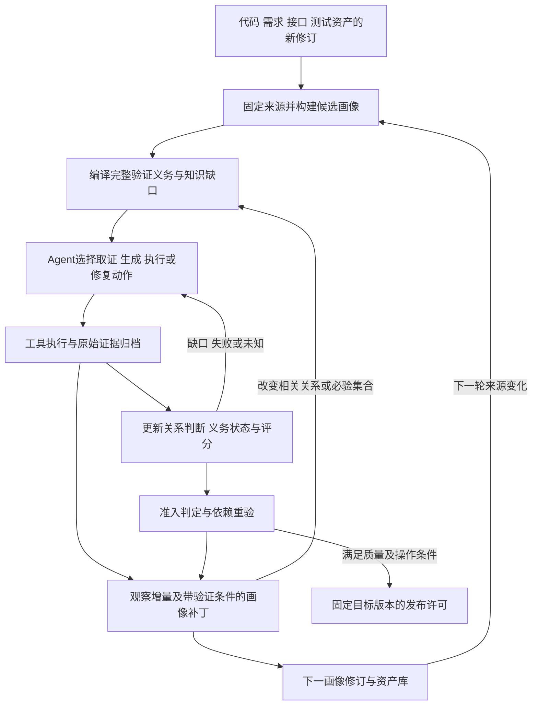

# Nasus：系统画像与集成验证共同演进的自驱闭环方案

> 内部 Idea 与技术设计评审；核查日期：2026年10月29日（Asia/Shanghai）。
>
> 本文将画像构建、用例生成、自动执行、评分准入和迭代回流作为一个整体发明主题。新增协议和算法均为可实施设计，不表示已经完成产品实现或证明专利创造性。
>
> 实现依据：远程 `nasus_snapshot_v1` 于本轮核对仍为 `38e123c89fdb1dc8602a10f56f45fbdfdeb86e86`，提交时间2026年10月27日21:06:26 +08:00。当前分支 `2026/nasus_art_v2` 的产品代码及 `docs/design` 与该提交一致。本轮未运行产品测试。

## 1. 整体发明主题

候选名称：**一种基于验证义务驱动的系统画像共同演进、集成测试与发布准入方法**。

AI Coding 加速代码变更后，需求、接口、实现、测试资产和运行结果以不同节奏演进。系统认知不能只在项目开始时建立，验证也不能只在开发结束后孤立执行。画像需要持续回答：本轮目标版本应该满足什么、目前知道什么、尚缺什么依据、下一步采取什么行动，以及现有证据是否足以支撑发布。

本方案的整体技术思路是：

> 将多源材料构建成带版本、证据和关系状态的系统画像；从独立验收依据编译完整验证义务；把画像缺口、测试缺口和执行反例统一转为可验证的行动目标，由大模型选择取证、关联评估、生成、执行或修复动作；根据目标版本的实际证据更新义务状态和准入判断；通过带依赖及验证条件的画像补丁吸收本轮成果，并驱动下一轮增量验证。

三个相互配合的候选贡献为：

1. **验证目标反向驱动画像构建。** 画像应能提供触发条件、预期、观察对象和执行路径；缺少这些内容时，自动形成定向调查问题，而非只增加摘要或关联数量。
2. **未兑现义务驱动自主行动。** 同一组义务贯穿检索、分包、生成、执行和准入；测试被淘汰、预算耗尽或模型改写计划时，义务仍然存在，并决定下一步动作。
3. **画像变更与验证结论同步演进。** 来源变化和运行反馈形成两类增量；画像补丁同时说明关系变化、受影响义务、证据失效及补验要求，防止画像已更新而准入仍沿用旧结论。

整体性来自上述数据和状态之间的相互约束。多源导入、图谱、大模型、版本号、审批或评分公式单独不作为已确认的创新。

## 2. 背景与现有技术边界

| 技术问题 | 本方案针对的失效情形 | 本方案需要形成的作用 |
| --- | --- | --- |
| 多源认知失配 | 名称相似、文档引用或代码调用被直接解释为业务实现或测试覆盖 | 按关系类型建立证据条件，并保留支持、反证及未知 |
| 画像不支持实际验证 | 图谱存在节点和边，但不能回答如何触发、观察和判断 | 通过验证上下文试编译反向生成画像调查任务 |
| 自主循环偏离目标 | 增加文本、重复调用或获得新哈希被当作进展 | 用实际缺口消除和目标证据资格变化衡量进展 |
| 必验内容消失 | Top-K、上下文预算、淘汰失败用例减少了实际验证责任 | 固定完整义务分母，允许换用例和换动作，不允许静默删义务 |
| 错误准入 | 最新成功、历史通过率或平均分掩盖本轮关键失败与未知 | 逐义务校验目标证据，硬条件先于综合评分 |
| 反馈污染后续画像 | 把实际错误行为学习为正确预期，或重复使用旧通过结论 | 分开保存观察、候选解释和批准预期，联合更新适用性 |

本轮主要对照如下，以下归纳以公开技术内容为准，不推断审查员的授权理由。

| 公开工作 | 已公开的相关内容 | 本方案要比较的具体关系 |
| --- | --- | --- |
| [CN121935166B](https://patents.google.com/patent/CN121935166B/zh)，2026，权1 | 增量图谱、控制/数据流影响分析、风险及覆盖驱动选路径、执行后调整关系和路径权重 | 完整义务是否跨构建、测试淘汰和画像补丁保持，以及补丁是否联动证据资格和准入 |
| [TestAgent](https://arxiv.org/html/2607.09101v1)，2026，III-B—D、IV-A5 | 测试专用图谱、三 Agent 自主工具调用、执行反馈及接受/丢弃/更新/补充；实验为控制上下文处理规划器生成的前5项测试需求 | 独立验收来源与完整必验分母；淘汰用例后义务继续驱动行动；目标版本证据支撑准入。其单元测试任务与本方案集成准入任务有差异，不能把实验截取推断为该方法永远不能扩展 |
| [EvoGraph-R1](https://arxiv.org/html/2607.12764v1)，2026，3.3—3.5 | Agent 自主检索、搜索、编辑图谱，利用反馈持续扩充和修正知识 | 自主改图并非新概念；需要比较软件验证义务、目标构建证据与图谱变更的联合状态协议 |
| [CN122044758A](https://patents.google.com/patent/CN122044758A/en)，2026，权1、4—10 | 按交付事件选择质量门禁和测试任务、环境快照、阈值判断及失败后更新数据重测 | 门禁如何使用画像编译的完整义务，以及画像补丁怎样使已有准入依据失效或恢复 |
| [CN121455447A](https://patents.google.com/patent/CN121455447A/zh)，2026，权1、4—6、9 | 多源需求证据、本体约束的关系抽取、差分传播和受限增量学习 | 关系假设怎样被实际验证需求和执行反例定向修正，并影响下游验证义务 |
| [CN121996618A](https://patents.google.com/patent/CN121996618A/en)，2026，权1、2、5—7 | 图谱与向量对齐、版本化证据包、受约束生成及生成后反向检查 | 检索材料之外的必验集合，以及缺口到自主行动、运行证据和画像更新的绑定 |

另有高度相关的摘要级线索：[GraphRAG-Driven Self-Healing Multi-Agent Framework for High-Performance Resource-Efficient Modern Sustainable Software Systems](https://ieeexplore.ieee.org/abstract/document/11688270/)，2026。出版社摘要描述版本化软件知识图谱，以及监控、诊断、生成、修复和验证 Agent 的 MAPE-K 闭环。本轮仅核读摘要，未取得全文，不据此推断其没有披露某项具体机制。

这些文献已经覆盖闭环中的许多组成部分。上述整体协议是否具有创造性，仍要结合其具体限定与现有技术组合评价；本文不以“未在一篇中找到全部内容”直接认定可授权。通用依赖失效、主动学习、反例驱动修正、任务调度和事务控制也不能仅凭换名成为独立发明点。

## 3. 总体闭环与大模型分工



一个持久化协调器管理 iteration、工作项、预算和恢复。画像分析、测试生成、失败分析和评估可以由多个模型角色承担，也可由同一模型分阶段承担；多 Agent 数量不是必要创新限定。

大模型负责跨源语义推理、竞争解释、动作提议、用例及脚本生成、失败归因和风险评估建议。解析器、索引、执行器与判定器负责可重复的事实处理。模型产生结构化输入，由工具执行；模型语言判断本身不改变正式通过状态。业务规则不明确时保留缺口，不要求模型猜出一个预期。

“自驱”指在已配置来源、工具、测试环境和成本范围内，系统可以连续选择并执行有效动作，自动进入下一阶段。关键业务预期、权限或发布策略需要变更时，进入明确的外部决策状态；这不是每一步都要求人工点击。发布许可与部署动作分开，只有部署授权和目标绑定均满足时，下游部署服务才能消费许可。

## 4. 核心数据对象

下列为统一闭环的目标契约；字段可复用已有对象，不要求另建平行业务主库。

| 对象组 | 关键字段 | 关键用途 |
| --- | --- | --- |
| 来源与画像 | `binding_id, source_revision, inventory_digest, completeness, image_revision, parent_image, manifest_digest` | 代码、需求、接口和测试资产分别固定来源；来源缺失与真实删除分开 |
| 关系假设 | `claim_lineage, claim_revision, predicate, endpoint_pins, evidence_pins, query_scope_pins, applicability_scope, status` | 记录语义类型、端点修订、支持依据及适用条件；同一材料的不同摘要不算独立证据 |
| 关系验证条件 | `support_predicate, refute_predicate, required_observations, approved_oracle_pin, evaluator_version` | 候选关系需要什么依据才能支持、反驳或保持未知；条件先于取证固定 |
| 迭代契约 | `iteration_id, contract_revision, image_pin, source_manifest, target_build, scope_pin, obligation_set_digest, policy_pin, environment_contract` | 所有行动、结果和准入共享目标；实质依赖变化形成新契约修订 |
| 义务与缺口 | `obligation_lineage, obligation_revision, authority_pin, oracle_digest, mandatory, weight, dependencies, gap_reason, status` | 稳定追踪业务责任，逐轮固定判据；本项目当前 row ID 含 scope 修订，跨轮 lineage 是新增设计 |
| 行动 | `action_id, input_digest, gap_ids, tool, predicted_outcomes, success_predicate, cost_limit, attempt, idempotency_key` | 说明要解决哪个问题、什么观察有区分力，以及实际完成条件 |
| 执行与评估 | `plan_pin, case_pin, script_pin, build_digest, environment_digest, fixture_digest, batch_id, attempt_id, observations, verdicts` | 区分计划覆盖、原始观察和适用于目标的判据通过 |
| 画像补丁 | `base_image, source_delta, observation_delta, claim_changes, affected_obligations, evidence_revocations, validation_results, expected_head` | 同时表示知识变化和对测试结论的影响，提供可审查的增量 |
| 准入与迭代归档 | `contract_pin, evidence_set_digest, assessment_policy, decision, blockers, expected_release_target, patch_pin, disposition` | 把判定、目标和后续画像联系起来；`disposition` 可以是发布、阻断或中止 |

`lineage` 只用于追踪对象沿革，不赋予新版本通过资格。身份歧义、拆分或合并需要显式映射；不能按名称相同或模型相似度自动继承。

## 5. 八步处理方法

### S101 固定多源输入并建立基础画像

输入上一画像和本轮代码、需求、接口、测试资产。分别固定仓库 commit、文档修订、接口契约修订和测试资产修订，建立完整采集清单。代码采用 AST/结构分析，显式接口采用 OpenAPI、事件 Schema 等适配器，需求采用结构化抽取并保留原文，历史测试提取步骤、断言和 fixture。

结构事实、批准预期和模型假设分别存储。接口专用适配器和任意文档语义抽取是目标设计；当前显式文档解析能力不能直接表述为这些能力均已实现。外部知识库提供术语、协议和测试方法，不能直接成为当前项目业务预期或本项目调用关系的证明。

输出来源固定的基础画像及采集缺口。某文件本轮未观察到，仅在采集范围完整、可比且无不可读屏障时才判删除；否则进入未知并扩大相关验证范围。

### S102 生成带证据与验证条件的跨源关系

以实体身份为锚点，结合显式引用、关键词/向量检索及结构邻接生成候选端点。模型在固定候选和原文范围内判断关系，返回支持、矛盾、无关或未知，并附双端证据。检索为空也保存查询范围；历史否定按端点及来源修订筛选后再截取候选，避免更换模型调用绕过否定。同一绑定下端点和来源修订均相同的否定继续排除；任一相关修订改变进入待重评；身份连续性无法证明时先解决身份，不自动继承接受或否定。

关系类型决定需要的依据：

- `references`：存在明确引用，只证明提及关系。
- `implements`：代码路径及行为与批准条件的对应解释；有证据可审阅，不单凭引用成为正式通过。
- `asserts`：测试断言与独立验收预期对应，需绑定观察对象和步骤。
- `observed_interaction`：在指定构建、环境、输入和时间区间中观察到的交互，不扩大为所有执行条件下必然发生。

本设计新增的机制是给关键关系附上可检查的支持/反证条件。例如“重复回调不会重复记账”须对应回调身份、账本业务键及计数观察，不能以文本相似度分数代替。机器可执行条件由受限表达式或已批准断言适配器表达；无法机械判断的语义关系保持待审阅。

### S103 通过下游可验证性检查反向完善画像

对目标行为试编译四个槽位：**如何触发、依据什么预期、观察哪个对象、如何在隔离环境判定**。缺失任一槽位就形成 `EvidenceGap`，绑定相应关系、义务、来源和修订。

模型提出有区分力的动作，例如读取某条事件订阅、查接口幂等字段、检查账本关联键或运行已授权诊断用例。每个动作必须事先列出不同可能观察分别支持/反对哪些解释，以及结果为无效或不可区分时的处理。受限表达式只引用允许字段，模型生成的表达式经过类型和单位校验；不能借“验证条件”执行任意代码。

动作输出通过原文、trace 或测试回执核验后才更新关系状态。诊断探针与正式验收用例分开；探针观察可改善画像，但只有正式绑定验收判据及计划的执行才计入通过。

### S104 编译本轮完整验证义务并复用资产

义务来源包括新增行为、直接影响、风险政策要求的间接影响、历史故障保护项和全局规则；以批准 AC/契约为判据来源。模型可提出遗漏场景，规则将其归类为必验、可选或待判；待判且可能影响关键行为时阻断准入，不能按可选项静默丢弃。

固定 `M` 为必验集合，`O` 为本轮采用的可选集合，固定权重、判据及集合摘要。既有用例和脚本在输入、判据及执行条件适用时复用；缺失部分由模型生成。每项义务必须有用例或显式缺口，丢弃用例只会重新产生缺口。预算首先保证完整 AC、联合条件和全局规则；超限分包，无法容纳的不可分单元明确阻断。

生成校验核对引用、判据、步骤映射、全局规则及义务归属。发现新必验项时追加 scope/contract 修订并重新冻结分母；模型不能为提高评分修改本轮分母。当前上下文分包的字节预算与执行生成批次的实际 tokenizer/token 容量分开计量。

### S105 自动构建并执行固定计划

RunPlan 固定画像、义务、用例/脚本修订、目标构建、配置、依赖服务、测试数据和执行批次。编译检查、fixture 建立、定位信息、授权和目标构建核验通过后，由工具运行；模型据环境缺口选择补齐动作，而不是编造“运行通过”。

执行前登记派发，回执按用例、动作、观察对象和判据归档。异步场景固定相关 ID、观察窗口、截止条件和查询策略。明确观察到违背业务时限可判失败；观察服务不可用、回执丢失或无法确认执行结果则为未知，二者不混淆。

claim 已存在但无 outcome 时先恢复原回执。不能直接重发可能导致重复扣款的请求；若确需新尝试，使用明确重试规则、独立 attempt 和隔离数据。目标代码修复形成新构建、新计划及新执行证据，历史通过不自动转移。

### S106 大模型驱动评估和补证，事实决定准入资格

模型接收完整结果摘要和按需取回的固定证据，输出结构化的失败解释、风险类别、未决问题、评分建议及下一动作。候选解释必须指出证据支持范围；模型之间投票一致仍只是辅助证据。

判定器核对目标、计划、脚本、判据、环境、fixture、批次和原始观察，将每项义务标为 `passed / failed / unknown / missing / stale`。结果冲突不能用最后一次成功覆盖；未解释的同构建失败跨契约修订保留阻断，flaky 通过规则也必须预先固定。

评分及准入使用第7节的规则。未通过时，失败或未知重新进入 S103/S104/S105 的工作队列；代码问题可交给已授权编码工具形成候选修复提交，经构建适配器产生新目标后再次验证。编码工具未配置或业务规则需要决定时，保存原目标并等待明确依赖，不伪装自主成功。

### S107 把来源变化与运行反馈编译成画像补丁

两类输入共同触发：`source_delta` 表示代码、文档、接口和资产变化；`observation_delta` 表示执行结果、反例、缺陷复现和已核验交互。失败观察在产生时立即归档，不等待发布成功。

补丁先计算受影响关系及完整查询范围依赖，再展开义务、脚本、执行资格和准入依据的依赖闭包。新增文件、原空查询、动态调用或分析截断导致不确定时，扩大到所属范围，不能声称无影响。模型只提出局部补丁及解释，确定性校验器检查端点存在、证据范围、原决定适用性、约束完整性和依赖闭包。

补丁验证同时回答：原缺口是否有证据地消除、是否引入新冲突、必验集合是否变化、哪些结论必须停止用于当前版本。补丁对业务语义的修改仍须相应权威或独立审阅；结构与观察更新可按预先批准的策略自动接纳。当前采用保守失效，新增细粒度闭包和自动恢复是设计，不宣称已实现全项目精确分析。

### S108 形成准入结果、下一画像与下一轮目标

提交前重验契约、目标构建、批准预期、关系决定、门禁政策及相关来源；同一发布目标已变化则旧判定失效，重新编译。对其他独立分支的变化按依赖范围判定，不能无条件阻断整个项目。

以 `IterationClosure` 关联本轮判定、证据集合、来源清单和反馈补丁。软件发布许可与画像修订有各自状态，不能互相冒充：失败轮可以发布只读的失败观察和经批准知识修订，但不能获得软件放行；知识画像完成也不代表测试通过。

为避免循环依赖，准入始终引用**执行前固定的画像及本轮经核验的结果集合**。仅追加本轮历史观察的补丁不改变执行前提；若补丁改变实现关联、验收依据或必验范围，则必须形成新契约并重评，不能把它作为原决策的事后佐证。默认新计划不直接继承旧计划的通过结论。

画像发布采用预期 head 条件提交，并记录与准入结果的对应关系。发布许可保存目标、依赖摘要、有效期和许可 epoch；部署服务消费时同时核验许可有效性、当前批准/政策/相关依赖和目标，不能只检查构建未变。批准撤回或相关依赖变化使未消费许可失效。撤回与消费在准入服务内使用同一许可状态/epoch条件转换；消费记录通过条件写入获得唯一派发权，重复请求恢复原派发回执，不重复部署。外部部署和图谱存储不假定能跨系统原子提交，采用持久状态、幂等回执及恢复流程；部署结果未知就保留未知。派发后发生撤回须进入停止或回滚处置，不能声称已经撤销外部副作用。

下一轮将通过审阅的用例/脚本、知识关系、历史反例及新代码/文档/接口修订作为输入。来源事件去重、合并后形成新 manifest，定期对账补漏。运行观察不能改写正式预期；生成资产携带生成来源，不能循环引用自身作为独立业务权威。

## 6. 自主行动选择与增量更新算法

### 6.1 缺口驱动选择

候选动作限于 `read_source / evaluate_relation / inspect_trace / generate_case / repair_script / execute_case / propose_code_fix / rebuild / request_authority` 等已注册能力。模型输出动作与假设区分表，调度器按以下顺序选择：

1. 必验或关键准入阻断优先，其次直接变更范围，再次可选探索。
2. 同级先处理依赖就绪的动作；调查/诊断动作须能区分当前解释，生成/修复动作须有资产验收条件与义务映射，正式执行动作须有固定计划、判据和证据采集条件。普通必验执行不强制要求存在竞争解释。
3. 按可影响的未决义务数量、政策风险权重与成本排序。模型估计只用于排序，不当作事实概率或完成证明。
4. 同一输入/动作/证据签名去重；同级任务保留老化优先级，避免低成本任务长期挤占必验工作。

```text
drive(goal, contract, ledger):
  base_image = read_immutable(contract.image_pin)
  observation_view = read_verified_iteration_journal(goal.iteration_id)
  while within_cumulative_goal_and_project_budget(goal):
    assessment = assess_snapshot_without_commit(contract, ledger)
    if assessment requires a new contract: return next_contract_required()
    if assessment.quality_satisfied:
      finalized = assess_and_recheck(contract, ledger)
      if finalized is ready or awaiting_authorization: return finalized
      if finalized requires a new contract: return next_contract_required()
      assessment = finalized
    residuals = derive_gaps(base_image, observation_view, ledger,
                           contract, assessment.blockers)
    candidates = model_propose(residuals, registered_capabilities, pinned_evidence)
    actions = validate_common_pins_and_kind_specific_completion(candidates)
    if actions is empty:
      return paused_with_exact_dependency(residuals)
    action = choose_by_policy(actions, age_and_cost)
    observed = execute_or_resume(action)
    checked = verify_observation(observed, action.input_digest)
    update_append_only_observation_journal(checked)
    patch = propose_and_validate_patch(base_image, observation_view,
                                      checked, action.gap_ids)
    ledger = update_verdicts_from_checked_evidence(ledger, checked)
    if patch changes contract dependencies or mandatory set:
      return next_contract_required(patch, preserve_all_history=True)
    observation_view = refresh_verified_journal_projection(patch)
    progress = verified_gap_transition_or_new_qualified_result()
    if repeated_no_progress(progress):
      return paused_with_exact_dependency(residuals)
  return budget_exhausted_with_unresolved_obligations()
```

`observation_view` 是本轮追加式证据日志的可重建投影，不原地修改 `contract.image_pin`。只有形成已核验补丁并提交新修订时才产生新的正式画像。可选集合阈值不足或风险待判也产生可调度 residual，不能因必验已经通过而反复提前返回。

外层协调器收到 `next_contract_required` 后，在必要权威条件满足时自动提交新画像/契约并重新调用 `drive`；缺少权威输入则保存原 Goal 等待。新契约、修复构建和恢复动作共享原 iteration/Goal 的累计预算、去重账本和无进展历史，不能通过换 ID 获得新额度。真正下一业务迭代的预算由预先批准的维护策略分配，并受项目时间窗口总额度约束。

缺口从“未知”变为“已证实失败”可以算认知进展，但仍是发布阻断。进展签名固定 `gap_lineage + 实质输入 + 新证据身份 + 有效状态迁移`；实质输入由相关端点/来源内容、判据修订、目标构建及工具策略固定，不使用任意新建的 context/contract ID 代替。同一证据造成状态反复切换不重复计数，模型改名不能制造新缺口。反复报告同一失败、增加哈希、提高自评分均不算新进展。新增高风险缺口会增加分母，不因总缺口数暂时增加而惩罚真实发现；按固定 gap 的证据状态迁移计量，不要求每轮图谱更大或缺口总数单调下降。

### 6.2 联合更新关系、义务和证据资格

```text
compile_patch(base, new_sources, new_observations, contract):
  delta = no_source_change() if new_sources is absent else \
          compare_same_binding_revisions_with_inventory_proof(base, new_sources)
  roots = changed_endpoints(delta) + changed_query_scopes(delta)
  roots += explicitly_scoped_counterexamples(new_observations)
  affected = dependency_closure(roots, claims, obligations, plans, decisions)
  if delta.unresolved or affected.truncated:
    affected = conservative_scope_expansion_or_block()
  changes = model_propose_relationship_repairs(affected, pinned_evidence)
  validate_types_evidence_endpoint_revisions_and_authority(changes)
  new_obligations = compile_complete_obligations(candidate_image(changes))
  revocations = evidence_no_longer_applicable(affected, contract)
  record_parent_and_lineage_without_transferring_pass(new_obligations)
  return patch(changes, new_obligations, revocations, unresolved_gaps,
               required_checks, expected_parent_head)
```

没有来源刷新事件时，纯观察增量保持原 manifest；只有明确的刷新结果报告采集失败或范围不完整时才产生来源未知。来源参数缺省不表示文件删除。

依赖集合可以表示多个替代支持集合，但必须明确 AND/OR 语义：一个必要依据失效使对应支持集合失效；只有另一个完整且仍适用的独立支持集合存在，关系才可保持适用。重复摘要、同一模型自述及同源复制不增加独立支持。运行通过结论还要满足目标构建等约束，不能因关系另有支持而自动恢复。

## 7. 评分、准出与状态转换

采用两个互相衔接的输出：模型形成风险解释和行动建议，判定器形成可复核的证据评分与准入状态。模型建议的风险类别按固定政策映射为权重和必验性；未被接纳的分类保持待判。权重必须是政策认可的有限正数，集合归属和权重不能直接采用未经校验的模型值。政策在本轮冻结，不能由执行结果反向降低标准。

一种可实施的展示分数为：

```text
Q = 100 × sum(w[o] × qualified_pass[o], o in M ∪ O) / sum(w[o], o in M ∪ O)
qualified_pass[o] = 1 仅当本轮判据的目标证据完整、有效且通过，否则为 0
```

Q 是**固定集合上的证据满足度**，不是系统可靠性概率，也不是经过实测校准的风险概率。空集合、缺少验收依据、非法权重或非正/损坏分母时 Q 为未知，不能默认100。图谱关系数量、模型置信度和历史其他构建通过率不增加本轮通过分。

```text
assess_and_recheck(contract, ledger):
  if not valid_and_current(contract): return needs_reassessment
  if any unresolved_critical_conflict_or_mandatory_failure(ledger): return blocked
  if any mandatory_missing_unknown_or_stale(ledger): return needs_evidence
  if any unclassified_release_relevant_risk(): return needs_evidence
  score = compute_fixed_policy_score(contract, ledger)
  if score is unknown or not finite or outside [0, 100]: return needs_evidence
  if score below adopted_optional_risk_threshold: return needs_evidence
  decision = eligible_for_release_review(score, complete_evidence_digest)
  if not operational_authorization_valid(): return awaiting_authorization(decision)
  if not compare_current_dependencies_and_target_again(contract):
    return needs_reassessment
  return ready_for_exact_target(decision)
```

| 状态 | 进入条件 | 可自动推进的下一步 |
| --- | --- | --- |
| `investigating` | 关系、来源或观察方式缺失 | 取证、解析、关系评估、受控诊断 |
| `generating` | 义务明确但缺少可用资产 | 生成、编译检查、审阅或修复脚本 |
| `executing` | 计划、目标及前置条件有效 | 派发、等待、恢复原结果 |
| `needs_evidence` | 必验未执行、未知、缺证据或风险待判 | 补证、补测；无法完成则暂停 |
| `blocked` | 必验失败或关键冲突 | 归因、形成修复候选、接收新构建 |
| `needs_reassessment` | 构建、预期、依赖或政策变化 | 新契约及影响重编译 |
| `eligible_for_release_review` | 固定质量条件满足 | 自动生成有依据的准入报告并检查操作授权 |
| `ready` | 质量、授权及提交前重验均通过 | 输出只适用于确切构建的发布许可 |

引用、哈希和结构校验只能证明绑定及内容一致，不能自动证明业务语义正确。关键业务判断须由批准预期、可执行判据或明确的独立审阅支撑；证据不足时保留未知。

## 8. 两轮退款构造实施例

以下仅为设计推演，不是 Nasus 真实运行结果。为易读定义逻辑义务 O1—O7；实际代码编译可能产生更多义务行，不能把表中数量当作现有实现输出。

共同条件：独立订单与商户账户、支付模拟服务、只读账本核对、受控身份、唯一 request/event ID、固定测试时钟及异步截止。金额单位为分，退款60元表示6000分。

### 第一轮：全额退款扩展为部分退款

导入代码 C1、需求 D1、接口 A1、历史测试 T0，固定目标构建 B1。批准预期要求允许部分退款、累计不超实付、重复请求只处理一次、越权拒绝、支付与账本一致。

| 义务 | 可实现用例与独立预期 | 画像缺口/行动 |
| --- | --- | --- |
| O1 部分退款 | 实付100，顺序退款60及40，分别成功，余额归零 | 定位金额字段及状态转移 |
| O2 累计限额及并发 | 独立订单实付100，并发请求80及80，恰好一个成功，另一个额度不足 | 找到原子额度检查及隔离并发 fixture；“两次都拒绝”不满足预期 |
| O3 请求幂等 | 同 request ID 重复提交60，仅一次支付及一次记账 | 历史用例若只断言“成功”，产生断言缺口 |
| O4 权限 | 非授权角色退款被拒绝且没有支付/账本副作用 | 定位身份 fixture 和拒绝后的只读观察 |
| O5 跨服务一致 | 在对应测试订单中，支付退款与账本金额、业务键及累计额度一致 | 解析订单、支付和账本之间可核对的关联键 |

旧用例可复用步骤，但模型必须补足遗漏断言；不能因历史用例名含“幂等”就确认 O3。LLM 对 O5 缺少账本业务键的情况选择读接口/代码或受控 trace，确定观察路径后再生成脚本。五项均取得 B1 的合格证据时，构造等权 Q=100，依赖重验及操作条件满足后产生 B1 许可。

本轮新增用例、脚本、被支持的交互关系、结果和未决项进入反馈补丁。下一画像 I1 保留本轮证据链和资产来源，完成第一轮闭环。

### 第二轮：同步处理改为异步回调

输入 C2/D2/A2；新增 callback 文件，即使旧检索从未命中过它，也因对应查询范围变化触发重新调查。O1—O5 保留业务沿革但新建本轮义务修订，增加 O6“截止条件内完成异步状态收敛”和 O7“重复回调只记账一次”。B1 的通过结果仅供历史参考。

| 阶段 | 系统实际应执行的动作及结果 |
| --- | --- |
| 形成竞争解释 | H1：业务回调缺少事件级幂等；H2：测试派发重复或数据未隔离。模型需明确两者对应的预期观察，不能立即认定 H1 |
| 选择区分动作 | 检查原派发/请求日志、event ID、回调接收记录和 ledger 写入关联；若仍不够，创建独立订单，在批准的诊断计划中显式发送两次相同 event ID，再只读核对 |
| 发现反例 | B2 下同一退款60出现两笔各60的账本记录。证据完整时 O5/O7 失败，保留反例；若关键关联日志缺失，则归因仍未知，不伪造根因 |
| 模型自主推进 | 输出带证据的修复候选和补充回归；可用编码能力在授权范围产生候选提交，经构建工具形成 B3。不能把预期改成“至少有一笔记录”来修复测试 |
| 重新验证 | 新画像候选、契约、RunPlan 绑定 B3；复用仍适用的资产，重新产生目标证据。并发、重复请求、重复回调及受影响历史项均在集合中 |
| 准入与回流 | B3 必验全部有效通过后重验依赖并判断准入；反例、修复关联和新增测试分别按证据/候选/批准资产进入 I2，下一迭代优先保留该故障保护项 |

等权演示：若 B2 的7项中5项通过、O5/O7失败，Q=71.43仍是阻断；若另一场景6项通过、1项因观察服务失联而未知，Q=85.71仍不能准入。B3 的7项全部满足才可进一步检查授权及发布竞争。上述算分只是公式示例，不是产品测量。

失败轮的观察和经验可以持续进入知识历史。正式业务预期始终来自批准 D1/D2，不因 B2 的重复记账而被改写。

## 9. 技术保护组合

### P0 核心整体组合

一种软件系统画像与集成验证共同演进的方法，包括：固定多源修订生成带证据的关系候选；根据目标验证要求生成关系验证条件与完整义务集合；将未满足义务和关系缺口映射为大模型可选择的工具行动；核验实际行动及执行证据以更新关系和义务状态；将来源变化与运行反例形成带依赖、受影响义务及结论失效信息的画像补丁；依据目标版本的有效义务证据形成准入结果，并使经核验补丁进入后续画像以驱动下一轮验证。

P0 的关键联系是：**同一义务和证据依赖同时约束画像完善、动作选择、准入和更新**。下表是该整体组合的进一步限定，不要求将每项拆成独立申请。

| 保护点 | 具体技术限定 | 对应步骤 | 作用机制 |
| --- | --- | --- | --- |
| P1 验证驱动的关联构建 | 按关系类型固定端点、证据及支持/反证条件，以验证上下文缺槽反向产生调查问题 | S101—S103 | 使画像具备支持实际验证的可用信息，而不仅是相似关系 |
| P2 义务驱动自主行动 | 缺口具有机器可检查的关闭条件；模型提出竞争解释与区分动作；只有有效证据状态迁移计进展 | S103—S106 | 约束自主探索的目标和停止条件，减少无效循环 |
| P3 完整义务跨阶段保持 | 固定分母、完整分包、全局规则继承；删用例仍保留义务；新必验项形成新契约 | S104—S106 | 避免模型和预算选择把未验证责任隐藏 |
| P4 来源及观察双增量 | 同一补丁绑定来源变化、反例、关系修订、受影响义务和旧证据撤销；包括空查询及新增文件依赖 | S107 | 让知识更新同步改变验证责任和结论适用性 |
| P5 准入反向驱动补证 | 目标证据逐义务校验，模型根据失败/未知选择后续行动；硬条件先于评分，提交前重验 | S105—S108 | 准入缺口持续驱动调查和测试，防止平均分或旧成功误放行 |
| P6 分层反馈及防循环自证 | 运行观察、候选归因和正式预期分离；补丁验证后更新；生成资产不得自举为独立预期 | S102、S107—S108 | 允许失败经验沉淀，同时避免错误行为成为正确标准 |

方法、系统、电子设备和存储介质可以围绕上述同一处理过程表达。候选系统包括来源/画像服务、义务编译器、Agent 协调器、执行证据服务、补丁校验器及准入服务；保护重心是它们共同处理的数据和状态转换，不是模块名称。

与已读文献相比，更值得论证的区别是 P1/P2/P4/P5 通过完整义务和证据依赖形成的整体联系。仅用常规图谱、规则、状态机和事务把模块串起来，仍可能是容易想到的组合；需要用下述失效与对照场景证明具体协同作用，不作已证实创造性的结论。

## 10. 当前实现与新增设计的接点

| 环节 | 本轮代码证据 | 状态及需补齐的内容 |
| --- | --- | --- |
| 多源固定与差异 | [source_delta.py](../../../apps/api/app/domain/system_image/source_delta.py)，比较入口129行 | 已有同绑定双修订和采集完整性规则；接口专用适配器及完整自动维护属于扩展 |
| 模型语义关系 | [semantic_evaluations.py](../../../apps/api/app/application/system_image/semantic_evaluations.py)，140行；[semantic_links.py](../../../apps/api/app/domain/system_image/semantic_links.py)，70行 | 已有真实调用和双端证据校验；竞争解释、动态区分动作与运行反证编排为新增设计 |
| 关系历史适用性 | [semantic_applicability.py](../../../apps/api/app/domain/system_image/semantic_applicability.py)，46行 | 已有端点/来源修订与历史决定适用性；与全轮义务、RunPlan和准入的联动需补齐 |
| Agent 调查 | [image_investigation_plans.py](../../../apps/api/app/application/agent/image_investigation_plans.py)，72行；[investigation.py](../../../apps/api/app/domain/system_image/investigation.py)，95行 | 当前调查工具范围有限且零模型调用；新hash或新证据pin仍可计进展，未达到本文的有效缺口迁移规则 |
| 完成判断 | [build_completion.py](../../../apps/api/app/domain/system_image/build_completion.py)，65行 | 当前报告保留 blocked、candidate_ready=false；本文完整自主闭环未实现 |
| 义务生成与分包 | [test_design_generation.py](../../../apps/api/app/domain/quality_loop/test_design_generation.py)，24、112行；[generation_batches.py](../../../apps/api/app/domain/quality_loop/generation_batches.py)，12行 | 已有完整义务、原判据及分包校验；跨版本义务lineage和统一IterationContract为新增设计 |
| 执行与原始观察 | [run_plan_case_execution.py](../../../apps/api/app/application/quality_loop/run_plan_case_execution.py)，161行；[run_plan_observations.py](../../../apps/api/app/domain/quality_loop/run_plan_observations.py)，104行 | 已有派发、归档、恢复及unknown；仍返回business_coverage_verified=false、正式通过计数0 |
| 旧评分与新证据衔接 | [release_readiness_repository.py](../../../apps/api/app/infrastructure/persistence/release_readiness_repository.py)，46行；[release_readiness.py](../../../apps/api/app/domain/quality_loop/release_readiness.py)，86行 | 旧链主要按project/us读取旧Run和上下文，尚未接本轮新RunPlan/构建/义务分母；本文评分及准入桥接需新增 |
| 增量与反馈 | [derivation_impact.py](../../../apps/api/app/domain/system_image/derivation_impact.py)，100行；[context_invalidation_repository.py](../../../apps/api/app/infrastructure/persistence/context_invalidation_repository.py)，127行 | 已有有界保守失效；全项目画像补丁、运行反例联动、正式资格恢复与自动下一轮为新增设计 |

现有[自主画像主方案](../../design/system-image/autonomous-system-image-design.md)已经描述缺口调查、行为重建及持续维护；[长期质量闭环](../../design/system-image/quality-closure-enablement.md)也包含测试、准入和反馈目标。本文补充的是“验证条件—行动—原始观察—补丁—义务—准入”之间的具体协议，不把已有目标重新命名为新增实现。

实现时可沿既有域补齐三个衔接面：在 system_image 增加关系验证条件和补丁校验；在 quality_loop 增加逐义务正式证据资格与准入投影；在现有 AgentGoal 编排中接入残余问题驱动的行动策略及两域事件。无需先替换关系存储、图数据库或通用 Agent 框架。

## 11. 技术效果与验证口径

| 机制 | 预期技术效果 | 可验证指标 |
| --- | --- | --- |
| 验证槽位反向调查、支持/反证条件 | 减少无依据关系，增加可生成、可执行的验证上下文 | 关系精确率/召回率、关键槽位缺失率、错误关联再次出现率 |
| 残余义务驱动行动和真实进展计量 | 减少重复读源、重复模型判断与无效重跑 | 每个有效关闭缺口的工具/模型成本、重复动作率、无进展轮数 |
| 分母保持与版本化新增义务 | 避免分包、淘汰用例或预算造成必验遗漏 | 必验保留率、未映射义务数、缺陷漏检率 |
| 双增量补丁联动证据资格 | 减少全量重分析，同时防止过期结论继续使用 | 受影响识别召回率、无关重分析比例、旧证据误接纳率 |
| 目标证据及准入前重验 | 减少错误放行和目标竞争 | 错误准入率、错误阻断率、版本变化到有效准入判断耗时 |
| 分层反馈和历史沿革 | 减少下一轮重复理解与资产生成，保留故障保护 | 资产有效复用率、故障再现检出率、历史复核成功率 |

评价同时比较全量回归、常规影响选测、图谱Agent测试闭环和本方案；以实际可复现实现和同等范围为准，不把论文公布数字直接作本项目基线。消融依次移除验证反向调查、完整义务保持、查询范围依赖和补丁—结论联动。耗时和成本必须与缺陷检出、遗漏、错误准入及误阻断一同报告。

设计核对场景至少包括：新文件命中原空查询、采集缺失被误判删除、历史否定被重复生成绕过、端点修订变化、分包超限、淘汰失败测试、模型弱化预期、重复派发、异步未知、同构建矛盾结果、修复新构建、批准撤回、归档损坏、发布目标竞争、失败轮回流，以及反馈补丁改变本轮必验集合。每种场景都要观察完整状态链，不能以局部校验成功代表端到端闭环通过。

上述效果为有机制支撑的待验证效果；本项目尚无完整闭环收益比例和本轮真实端到端实验结果。
