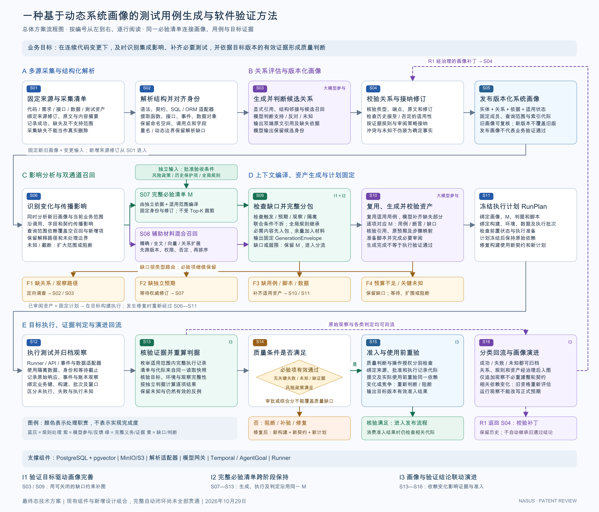

# 总体方案流程图与逐环节说明

**发明名称：一种基于动态系统画像的测试用例生成与软件验证方法**  
**用途：内部专利技术评审；日期：2026年10月29日。**  
**图示范围：最终态技术方案，由现有组件与新增设计组成，完整自动闭环尚未全部贯通。**

本方案面向 AI Coding 和持续交付中的连续变更：固定多源材料并构建带依据的动态系统画像，从变化和独立验收要求确定必须验证的内容，结合关联查询与混合召回组织测试生成，再依据目标版本的实际证据判断质量，并把经治理的知识带入下一轮。

## 总体流程图

[SVG 矢量图](./assets/overall-flow-2026-10-29.svg) · [高清 PNG](./assets/overall-flow-2026-10-29.png) · [Mermaid 可编辑逻辑源文件](./assets/overall-flow-2026-10-29.mmd)

图按编号从左到右、逐行阅读，共五个阶段、十六个步骤。F1—F4 是缺口的编号回跳，R1 是经治理补丁的回流；编号连接用来减少跨层长线。实线表示本轮处理，紫色虚线表示结果回流及后续演进。颜色区分处理职责，不代表功能完成状态。

图中三个共用对象：

| 对象 | 含义 | 关键约束 |
| --- | --- | --- |
| 画像版本 `ImageRevision` | 固定采用哪些来源、实体、关系和证据修订 | 新版不覆盖旧版；存在未知关系不被解释为现实系统没有该关系 |
| 必验清单 `M` | 本轮适用且必须验证的行为、条件和判据 | 由独立依据及范围确定；召回、预算和生成结果不能静默缩减它 |
| 执行计划 `RunPlan` | 固定画像、M、判据、脚本、目标构建、环境、数据与批次 | 计划覆盖、执行观察和有效通过分别记录；修复后使用新构建与新计划 |

## A 多源采集与结构化解析

这一阶段固定“本轮看了什么”，并从原始材料中提取可定位的结构信息。

| 编号与环节 | 输入 | 处理机制 | 输出及边界 |
| --- | --- | --- | --- |
| **S01 固定来源与采集清单** | 代码、需求、接口契约、数据结构、测试资产及可用的历史证据 | 为每个来源固定身份、修订、内容摘要和原文位置，记录成功、失败、排除及不支持范围 | 来源快照和采集清单。仅在完整、可比的范围内认定删除；采集失败不等于源对象被删除 |
| **S02 解析结构并对齐身份** | 固定原文及对应解析器版本 | 语法解析提取函数和调用点；契约适配器提取接口和事件；SQL/ORM 适配器提取数据读写；按仓库、服务、命名空间和字段路径区分实体 | 实体修订、结构关系和解析缺口。重名、反射、动态 SQL 或无法解析的调用保持未知，不能按名称相似强行连接 |

稳定身份与内容修订分别保存。对象重命名、拆分或合并采用明确的沿革映射；不同服务中同名的字段或函数不会直接合并为一个对象。代码语法解析提供结构依据，完整符号解析和跨服务数据流需要对应语言及框架适配器。

## B 关系评估与版本化画像

这一阶段回答“哪些对象有关、依据是什么、在哪个版本下适用”。

| 编号与环节 | 输入 | 处理机制 | 输出及边界 |
| --- | --- | --- | --- |
| **S03 生成并判断候选关系** | 结构事实、显式引用、候选端点及双方原文 | 先按类型、身份和结构范围形成候选对；大模型判断语义支持、反对、不相关或未知，并提供双方引用及缺失依据 | 带证据的候选关联。模型负责语义分析与缺口调查，不直接写入正式业务通过状态 |
| **S04 校验关系与接纳修订** | 候选关系、原文引用、已有决定及接纳策略 | 核验关系类型、端点和来源修订、原文定位及历史决定适用性；结构事实按规则处理，关键语义关联按审阅策略接纳 | 具有适用状态的关系修订。引用真实和字段合法不自动证明业务语义正确；同修订否定不能靠新建模型调用绕过 |
| **S05 发布版本化系统画像** | 通过相应规则的实体、关系、依据及未解决项 | 固定画像成员、来源清单、查询范围依赖和索引代际；保留旧版本，条件推进当前画像引用 | 可固定查询与复核的画像版本。画像发布表示形成受管理的知识快照，不表示所有依赖已知或软件已验证通过 |

画像关系包括调用、数据读写、接口与事件交互、代码实现验收条件、用例断言验收条件等。每条关系保存类型、方向、端点修订、适用条件及支持/反证证据。运行观察单独绑定构建、输入和窗口，一次观察不会自动升级为所有输入下恒成立的关系。

## C 变更影响与双通道召回

这一阶段确定“必须验证什么”，同时取得“如何理解和执行这些验证”的材料。完整必验通道与辅助材料通道承担不同职责。

| 编号与环节 | 输入 | 处理机制 | 输出及边界 |
| --- | --- | --- | --- |
| **S06 识别变化与传播影响** | 新旧画像、变化内容、当前业务范围及传播政策 | 首轮按范围初始化，后续比较同来源双修订；在各自固定画像内沿调用、字段读写、接口和事件契约传播；考虑新增对象对旧查询范围的影响，空召回也登记依赖 | 影响集合、解释路径、范围完整性和未解决边界。新旧路径不混接；未知或截断需要扩围或阻断，不能输出无影响结论 |
| **S07 编译完整必验清单 M** | 独立批准的验收条件、风险政策、历史保护项、全局规则及适用范围 | 枚举并按身份/修订归并义务；固定判据及权威修订；画像映射缺失保留为缺口 | 完整、可追踪的必验清单。必验性不由模型本轮生成数量、相似度或 Top-K 决定；移除原义务需要明确的新依据 |
| **S08 辅助材料混合召回** | 验证目标、变更、固定验收内容、画像及授权范围 | 精确标识、全文、向量和类型化关系扩展共同召回；先筛项目/版本/权限及适用否定，再融合排序、去重和截取；保留召回来源和查询范围 | 带原文定位、版本及依赖信息的支持材料。排序只决定辅助上下文，不能缩减 M；相似度不等于关系成立概率 |

S07 的独立输入在图中单独标示，避免将正式预期画成大模型或代码运行结果的产物。S08 的向量模型与索引模型配置保持一致；中文分词、标识符拆词和近似检索策略分别处理。影响遍历处理已登记依赖的完整范围，辅助召回可以按预算截取；二者不共用一个任意 Top-K 作为完成条件。

## D 上下文编译、资产生成与计划固定

这一阶段把要求转成可执行、可观察、可核对的测试，并显式管理尚未完成的部分。

| 编号与环节 | 输入 | 处理机制 | 输出及边界 |
| --- | --- | --- | --- |
| **S09 检查缺口并完整分包** | M、独立判据、业务路径、支持材料和可复用资产 | 检查触发、预期、观察、隔离四类信息；按联合条件依赖形成不可拆单元，全局规则随包继承；先容纳必需内容，再按预算加入可选材料 | 固定的 `GenerationEnvelope` 或类型化缺口。字节预算与模型 token 预算分别计算；必需内容超限不能靠删除条件解决 |
| **S10 复用、生成并校验资产** | 上下文包、适用用例和脚本 | 复用已有步骤，大模型补充缺失用例和断言；逐项核验引用、原预期、步骤映射和全局规则；每项 M 对应用例或明确缺口；脚本经过必要审阅 | 已校验的候选资产、覆盖映射及仍未解决的缺口。用例淘汰不删除义务；生成结构校验不证明业务语义或执行通过 |
| **S11 冻结执行计划 RunPlan** | 画像、M、判据、已审阅脚本、构建、环境、数据和批次 | 核验执行准备、前置状态、观察适配器及目标绑定，冻结原始依赖和派发身份 | 固定执行计划。未就绪项显式保持未执行/缺口；只执行可用项也不能缩减总必验清单。构建修复或相关前提变化使用新契约和新计划 |

### F1—F4 缺口分流

| 编号 | 触发条件 | 后续处理及关闭条件 |
| --- | --- | --- |
| **F1 关系或观察缺口** | 不知道哪些对象相关，或缺少读取业务结果的路径/关联键 | 回到 S02/S03 定向调查，再经 S04 接纳和 S09 复核；取得满足原固定条件的新证据后关闭 |
| **F2 独立预期缺口** | 缺少合法业务预期、适用范围或批准修订 | 等待权威输入，形成新依据后重新编译 S07；模型不能用当前实现表现补造预期 |
| **F3 测试资产或准备缺口** | 缺少用例、脚本、测试数据或执行准备 | 回到 S10/S11 补齐相应资产和前置条件；通过规定校验后才进入相应执行 |
| **F4 资源不足或关键未知** | 必需内容超预算、关键分析未完成或依赖无法判明 | 保留全部未满足义务，等待资源、扩大范围或阻断；不得无条件无限重试，也不能标记完整完成 |

缺口是否解决由其固定关闭条件判断。新增文本、增加图节点或更换上下文 ID 本身不代表进展。

## E 目标执行、证据判定与演进回流

这一阶段从实际观察形成质量判断，准入判断与知识回流分别处理。

| 编号与环节 | 输入 | 处理机制 | 输出及边界 |
| --- | --- | --- | --- |
| **S12 执行测试并归档观察** | 固定 RunPlan、隔离数据、身份和执行适配器 | 在目标构建执行；采集原响应、事件回执和业务数据观察，固定业务键、批次及等待窗口；保留原派发身份 | 原始执行观察及未执行/失败/未知状态。Runner 正常返回或 HTTP 成功不自动形成业务通过 |
| **S13 核验证据并重算判据** | M、批准判据、实际目标绑定及适用范围内的执行记录 | 服务端枚举完整执行记录，在同一一致性快照固定清单与代际；核验构建、环境、数据和观察完整性；从原观察重算判据并保留排除理由 | 逐义务的有效通过、失败、未知、缺失或过期状态。不能只选择成功记录，不能拼接不同业务键的局部成功，也不能用新上下文隐藏仍有效的反例 |
| **S14 判断质量条件** | 逐义务结果、固定风险政策及全部未满足项 | 必验项必须具有有效通过证据；关键失败、未知和证据缺失阻断；风险政策按固定口径判断 | 质量满足，或阻断/补验/修复。操作审批及综合评分不能覆盖关键质量缺口 |
| **S15 准入与使用前重验** | 质量结果、操作授权、来源/批准/查询范围/执行记录的相关代际 | 质量与操作授权分别检查；结论提交及实际使用时核验同一相关依赖，识别迟到结果、撤回和并发变更 | 目标版本有效准入结果，或重新评估/阻断。验证完成后发生变化，旧结论不能直接继续使用 |
| **S16 分类回流与画像演进** | 成功、失败、未知的原观察和判定，以及有依据的关系/资产变化 | 原始观察先归档；经治理关系、规则和资产可进入后续画像；根据实际依赖判断是否影响当前契约及结论资格 | 历史记录、画像补丁、重评或补验任务。运行观察不能直接改写正式预期；新画像不自动继承旧通过结论 |

### R1 回流与下一轮

S13 直接向 S16 提供各类结果，回流不以 S14/S15 准入通过为前提。业务失败也能成为后续调查和风险记录的依据，但不能产生发布许可。

回流按三种情况处理：

1. **仅追加观察**：归档并更新相关执行记录；可能引起旧判定重评，但不必重建整张画像或整轮契约。
2. **形成后续知识或资产**：补丁经 S04 校验后进入新画像，旧版本保留。
3. **改变当前依赖**：相关关系、批准依据、查询范围或执行记录改变，使原证据资格重新评估；必要时重新确定范围、义务和计划。修复构建按 S06—S11 重新组织验证。

新的来源修订从 S01 进入；不能直接把未经采集、解析和接纳的内容写入当前画像。F/R 回跳属于受资源与状态约束的后续动作，不表示无条件自动循环。

## 贯穿示例：异步退款回调

以下为构造场景，用于说明流程，非真实运行结果。

| 处理位置 | 退款场景中的具体动作 |
| --- | --- |
| S01—S05 | 采集新增回调文件、接口及账本结构，解析事件与记账函数；模型提出业务关联，校验后纳入新画像 |
| S06—S08 | 旧查询虽然没有命中消费者，仍因范围内新增文件而重评；保留“同一退款事件只能记账一次”的批准要求，并召回支付、订单和账本材料 |
| S09 / F1 | 发现缺少事件 ID 到账本查询的映射，形成观察缺口；调查并核验该关联键后关闭，幂等要求始终保留 |
| S10—S12 | 复用正常退款步骤，补充同事件重复回调；固定构建 B2、隔离订单及批次，取得回调完成和完整账本观察 |
| S13—S15 | 若批准金额为 6000 分而观察到两笔各 6000 分，判据失败并阻断；不能用接口成功或另一笔订单成功覆盖 |
| S16 与下一轮 | 失败观察进入历史和诊断；有依据的修复生成 B3，新契约、新计划和新证据重新判断，保留 B2 失败记录 |

## 图中候选创新组合的位置

| 标记 | 对应环节 | 具体相互约束 |
| --- | --- | --- |
| **I1 验证目标驱动画像完善** | S03、S09、F1/F2 | 独立必验项决定画像缺少哪些可验证信息；缺口有固定关闭条件，补图不能删除义务或改写预期 |
| **I2 完整必验清单跨阶段保持** | S07—S13 | 同一身份/修订的 M 贯穿召回、分包、生成、执行和证据接纳；预算、排序或资产淘汰不静默缩减分母 |
| **I3 画像与验证结论联动演进** | S13—S16、R1 | 完整适用执行记录决定证据资格；相关依赖变化同时影响画像使用与结论资格，提交和使用时再次核验 |

这些标记用于定位候选技术保护组合，不表示单独的图谱、缺口、版本号或门禁已经被证明具有创造性。相关比较见[现有技术与技术区别评估报告](./prior-art-and-technical-differences-2026-10-29.md)。

## 支撑组件与实现状态

| 组件或能力 | 在流程中的位置 | 当前事实边界 |
| --- | --- | --- |
| PostgreSQL/SQLAlchemy、pgvector、全文索引 | 画像事实、修订、关系查询与 S08 召回 | 已有事实存储和版本绑定检索基础；完整字段级邻接投影、中文分词及规模效果仍需补齐或验证 |
| MinIO/S3 | 原文、画像工件、模型输出和执行观察 | 已有归档基础；不把归档成功解释为业务验证通过 |
| Tree-sitter 与来源解析器 | S01/S02 | 已有固定来源结构解析及缺口记录；当前结构构建采用零模型流程，不能表述为大模型自主画像已经完成 |
| 语义模型网关及关联服务 | S03/S04 | 已有 `implements/asserts` 的固定输入、输出校验和审阅基础；跨服务契约/事件/SQL-ORM 关系仍需扩展 |
| 完整条件分包与生成校验 | S09/S10 | 已有相应组件；四类可验证性检查和跨轮稳定义务沿革属于进一步设计 |
| Temporal、AgentGoal、Runner | S11/S12 及缺口动作调度 | 已有工作流与原始观察基础；完整正式证据判定、准入及联动回流尚未全部贯通 |

图的当前代码依据沿用本轮核查的 `nasus_snapshot_v1@38e123c`，提交时间为2026年10月27日21:06:26（UTC+8）。本次只新增图与说明，没有修改产品代码、运行产品测试或验证端到端收益。

## 评审介绍文字

本方案首先固定代码、需求、接口和测试资产的来源修订，通过结构解析和大模型语义判断建立带证据、带适用状态的系统画像。发生变化后，在新旧画像及查询范围依赖上分析影响，从独立验收依据编译完整必验清单，并通过精确、全文、向量和关系查询取得支持材料。系统检查触发、预期、观察和隔离条件，缺少内容时定向补齐；条件充分时完整分包，复用或生成测试资产并校验。随后冻结目标构建的执行计划，从原始观察计算逐项结果，在质量满足、操作授权有效且依赖重验通过时形成准入结果。成功、失败和未知结果分别归档，经治理的知识进入后续画像，相关依赖变化同时使旧验证结论重新评估。

进一步的数据字段、传播规则、召回与判定算法见[技术实施方案](./technical-implementation-2026-10-29.md)。
